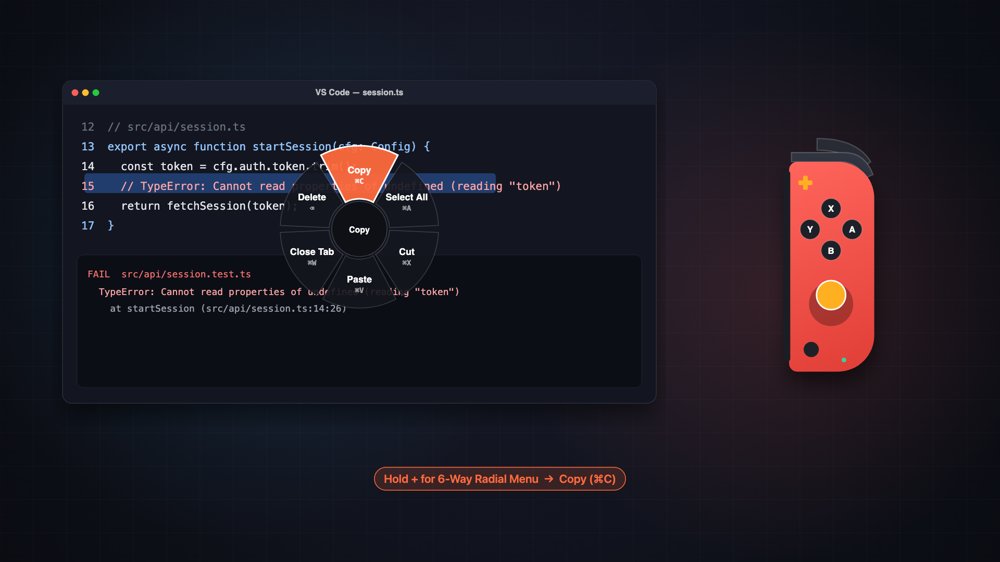

# JoyCon-Couch 🎮

**Turn a single 49g Nintendo Switch Joy-Con (Left or Right) into a couch vibe-coding & voice-dictation controller for macOS & Windows.**

No soldering. No firmware flashing. Zero third-party drivers on macOS. Slide it back onto your Switch anytime and it works like nothing happened.



---

## Why This Exists

With modern voice dictation (**Wispr Flow, Superwhisper, MacWhisper, Yuxie, Windows Voice Typing**) and AI coding agents (**Claude Code, Cursor, Codex, Antigravity**), typing is no longer the bottleneck — **pointing, dragging, switching windows, and copy/pasting from the couch is.**

Most Joy-Con mouse scripts feel awful on a 4K TV (jittery at small targets, painfully slow across the screen, terrible at dragging, and missing copy/paste). **JoyCon-Couch** fixes that from the ground up:

- **FPS-Grade Dual-Zone Cursor Curve** — Scaled radial deadzone + gentle micro-aim zone (pixel-accurate clicks) + **2.3× outer-edge ramp-up boost** to cross a 4K screen in 0.5s, plus **0.68× drag damping** while holding left-click.
- **Built-in 6-Way Radial Editing Shortcuts** — Tap `+`/`-` to Undo, **hold `+`/`-` + flick stick** for Copy, Paste, Cut, Select All, Backspace, or Close Tab.
- **One-Trigger Voice Dictation + Send** — Bind `ZR` / `ZL` to your favorite dictation hotkey (with **HD Rumble** confirmation), then tap `A` / `→` to hit Enter and send straight to your AI agent.
- **6-Axis Wrist-Flick Workspace Switching** — Flick your wrist left or right to swipe between virtual desktops (`Ctrl+←/→` on macOS, `Ctrl+Win+←/→` on Windows).
- **Left & Right Hot-Swap** — Right Joy-Con low on battery? Pick up the Left Joy-Con and keep going with 100% symmetric button mapping & automatic zero-drift calibration.
- **Built-in Web Settings Panel** — Runs locally at `http://127.0.0.1:43921` to bind your voice hotkey and tune cursor feel live.

---

## Symmetric Button Map (Right / Left Joy-Con)

| Right Joy-Con | Left Joy-Con | Action |
| :--- | :--- | :--- |
| **Stick** | **Stick** | Dual-zone cursor (or smooth scroll in scroll mode) |
| **Press Stick (`R3`)** | **Press Stick (`L3`)** | Toggle Cursor / Smooth Scroll mode |
| **`R`** | **`L`** | Left Click & Damped Drag |
| **`ZR`** | **`ZL`** | Trigger Voice Dictation (Push-to-Talk or Toggle) + HD Rumble |
| **`A`** | **`→`** | `Enter` (Send prompt to Agent) |
| **`B`** | **`↓`** | Right Click |
| **`X`** | **`↑`** | Switch Window (`⌘+Tab` / `Alt+Tab`) |
| **`Y`** | **`←`** | Mission Control (`⌃↑`) / Task View (`Win+Tab`) |
| **`+`** | **`-`** | Tap: Undo (`⌘Z` / `Ctrl+Z`) · **Hold + Stick**: 6-way Copy/Paste/Cut/Select All/Delete/Close Tab |
| **`Home`** | **Capture (`◻`)** | Lock / Unlock anti-accidental mode |
| **Wrist Flick L/R** | **Wrist Flick L/R** | Switch Left / Right Virtual Desktop |

---

## Quick Start

### 1. Pair Your Joy-Con via Bluetooth
Hold the small black sync button on the inner rail of either Joy-Con for 3 seconds until the green LEDs flash, then pair **`Joy-Con (R)`** or **`Joy-Con (L)`** in your OS Bluetooth settings.

### 2. Build & Run

#### macOS (Native Swift `IOKit` + `CoreGraphics` — Zero External Dependencies)
```bash
git clone https://github.com/tx0-zero/joycon-couch.git
cd joycon-couch
npm install
npm run build
npm start
```
> Grant **Accessibility** permission to your terminal in `System Settings → Privacy & Security → Accessibility` on first run.

#### Windows (Python `hidapi` + Native `user32.SendInput`)
```bash
pip install hidapi
npm install
npm run build
npm start
```

### 3. Bind Your Voice Dictation App
Open **`http://127.0.0.1:43921`** while running to pick your dictation shortcut (Superwhisper, Wispr Flow, Yuxie, Windows Voice Typing, or `F13`) and tune cursor speed & deadzone in real time.

---

## Architecture

- `src/mapper.ts` — 100% cross-platform TypeScript state machine (dual-zone response curve, radial deadzone, EMA smoothing, drag damping, 6-way radial selector, IMU wrist-flick detector).
- `native/JoyConHelper.swift` — Zero-dependency macOS native bridge using `IOKit.hid` & `CoreGraphics` with smart idle auto-calibration and HD rumble.
- `bridges/win_bridge.py` — Same JSON-Lines protocol for Windows using `hidapi` & `user32.SendInput`.

## License

MIT
